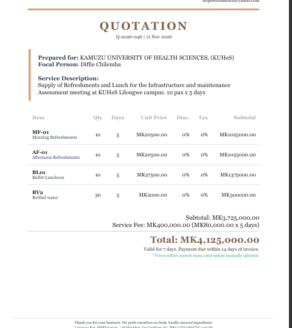
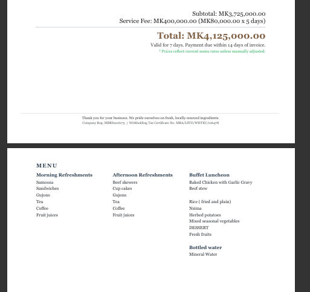
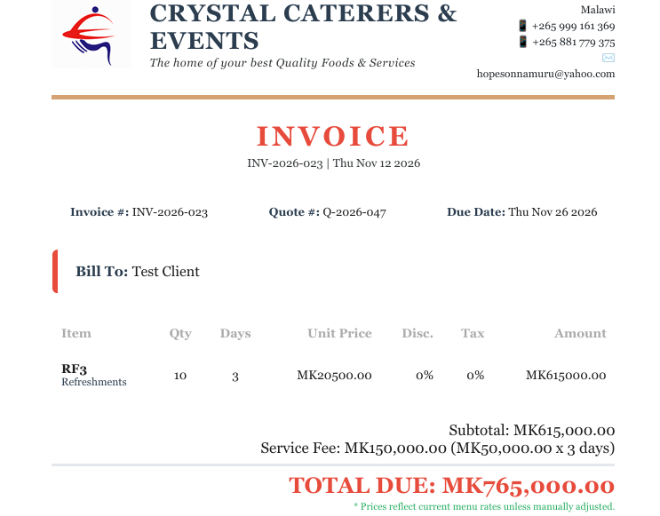
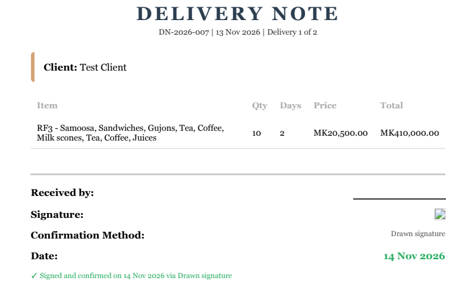
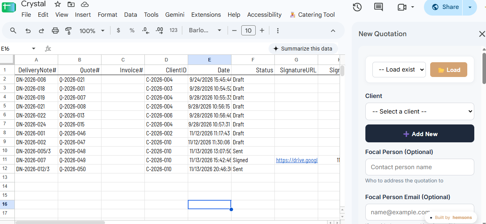

# CateringOPs-Automation Suite
A comprehensive, full-stack business management tool built entirely within **Google Workspace (Google Sheets & Google Apps Script)**. 

Designed for catering businesses, this system handles the entire client lifecycle: from generating itemized quotations and converting them to invoices, to managing multi-day delivery notes with electronic signatures, and sending automated payment statements.

## 🚀 Key Features

*   **📄 Automated Quotations & Invoices:** Generates beautiful, branded PDFs dynamically using custom HTML/CSS injected into Apps Script. Supports VAT, discounts, and multi-day pricing.
*   **📦 Multi-Day Delivery Notes:** Unique logic that allows a single quote to generate multiple delivery notes (e.g., `DN-2026-004/2` for "Delivery 2 of 3").
*   **✍️ Contactless Electronic Signatures:** Delivery notes are emailed to clients with a tokenized, secure link. Clients sign directly on their mobile devices, and a signed PDF is automatically generated and archived.
*   **🧾 Payment Receipts & Statements:** Auto-generates statements of unpaid invoices and formal receipts when payments are logged.
*   **⚙️ White-Label Ready:** Zero hardcoded business details. All branding, logos, banking info, and contact details are loaded dynamically from a `Config` sheet.
*   **🛠️ Admin & Health Check Tools:** Built-in diagnostic tools to scan for orphaned PDFs, duplicate database rows, broken references, and trailing empty rows.
*   **📱 Web App & Sidebar UI:** Runs seamlessly as a Google Sheets sidebar for internal staff, and as a deployed Web App for client-facing interactions (signatures).

## 🛠️ Tech Stack

*   **Backend:** Google Apps Script (V8 Engine)
*   **Database:** Google Sheets (relational structure: `Clients`, `MenuItems`, `Quotes`, `Invoices`, `DeliveryNotes`, `Config`)
*   **Frontend:** HTML5, CSS3, Vanilla JavaScript (Sidebars & Web App)
*   **Storage:** Google Drive API (Auto-saving PDFs and signature images to specific folders)
*   **Email:** GmailApp (Automated sending with PDF attachments and secure links)

## 📸 Screenshots

*(Insert your screenshots here!)*
*   '[Quote PDF with 3-column menu]'
*   '[Quote PDF with 3-column menu-Page 2]'
*   `[Invoice PDF showing multi-day service fee breakdown]`
*   `[Delivery Note PDF with electronic signature]` 
*   `[Sidebar UI]`


## 🏗️ Architecture & Code Structure

The codebase is strictly modularized for maintainability and scalability. All files share a global scope in Apps Script.

```text
📁 Apps Script Project
├── Config.gs                  # Environment variables, formatting, Drive helpers
├── Code.gs                    # Menu wiring, setup, client/menu lookups
├── Quotes.gs                  # Quote PDF generation & logic
├── Invoices.gs                # Invoice conversion, totals, PDF, payments
├── DeliveryNotes.gs           # Multi-day DN logic, PDFs, signatures
├── StatementsReceipts.gs      # Statements and payment receipts
├── Admin.gs                   # Health checks, cleanup, duplicate removal
└── *.html                     # UI forms (Sidebars & Web App)
